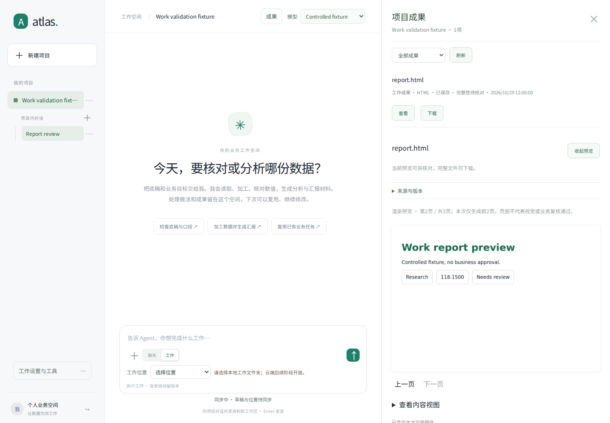
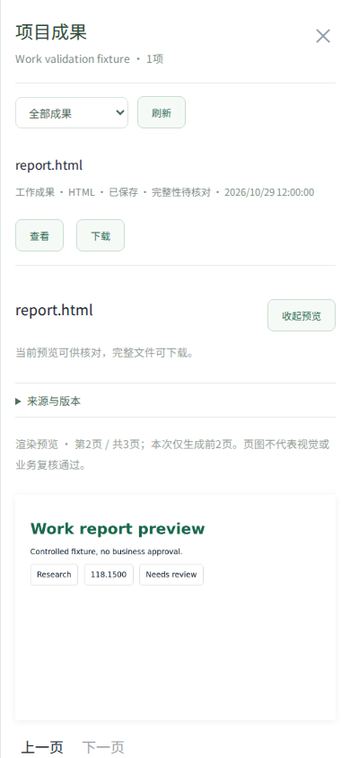

# 通用工作能力验证记录

日期：2026-10-29。开发基线：`b3fda681ae09081762bc37e4ff99eb86b11066d0`。

本轮增加公开研究与逐字引用、二进制成果续作、按页段渲染、成果页图展示、真实图像输入，以及可显式执行的五项模型任务验收。源码及验证摘要见 [机器可读记录](verification/general-work-20261029.json)，配置与能力范围见 [GENERAL-WORK.md](GENERAL-WORK.md)。

## 回归结果

| 检查 | 实际结果 |
| --- | --- |
| Python 全量回归 | 2129 passed、7 failed、34 skipped，654.38 秒 |
| 基线失败对照 | 七个失败名称与此前在独立原始工作树复现的失败完全一致，清单见 [前次记录](VALIDATION-WORK-MODE.md) |
| 最终相关回归 | 273 passed，55.73 秒；包括研究、执行、成果、权限、上下文、恢复、公司检索及工作流版本复用 |
| 前端 DOM 回归 | 21 个脚本全部通过 |
| 真实 Chromium 预览 | 1440×1000 桌面、390×844 手机：PNG 解码、翻页、部分页面提示、生成脚本不执行、页面无横向溢出通过 |
| 实际文件渲染 | 受控 HTML 经 Chromium / Playwright 生成 PDF，再由 Poppler 输出 PNG；受控 DOCX / PPTX / XLSX 经实际 LibreOffice 与 Poppler 输出 PNG，输入及图片摘要核对 |
| 打包与依赖 | Python wheel 构建及新增模块/静态资源检查通过；渲染器锁定 Playwright Core 1.64.1，`npm ci --ignore-scripts` 通过 |
| 模型验收清单 | 五项清单格式检查通过；未连接真实模型执行，分数为 null |

全量回归后，真实浏览器发现工作页图 URL 被前端地址校验拒绝，现已补上严格的项目内工作成果路径。同期将 HTML 打印改为固定 Playwright helper，补上重定向独立 TLS 连接池与渲染回读断线重试。以上最终修正已重跑相关 273 项及实际浏览器验证；全量数字对应修正前一轮，未据此宣称所有最终文件都又完整跑过全仓测试。

## 具体覆盖

- 网页：固定解析 IP、逐次跳转检查、TLS 主机身份、令牌不转发、Cookie 不传递、禁止私网/本机/元数据/组播、体积与存储预算、离线策略、项目和账号范围、搜索摘要不能作正文证据、逐字引用必须位于实际读取页、旧快照保留。
- 文件：明确选定原成果、校验完整字节与摘要、Office 二进制不经模型转录、旧版本保留、伪造渲染输入摘要被拒绝、临时断线只重读同一执行而不重跑程序。
- 视觉：兼容模型 HTTP 请求确实包含所选 PNG 字节；回执记录摘要和视觉意见，不把其升级为财务批准。使用的是明确标记的 HTTP 模型夹具，没有真实模型正确率结论。
- 预览：真实浏览器加载生产前端源码与 CSP，使用受控 API 响应。生成 HTML 不进入页面执行，PNG 解码后按页显示，旧地址范围和账号/项目变更防护继续保留。

## 预览截图

下图使用受控 API 和合成内容验证前端，含测试用中文字体，不是线上实例、真实业务数据或模型完成率证明。





## 验收边界

本环境没有 Docker daemon / gVisor，未构建或启动批准的工作镜像。实际文件渲染使用本环境 Chromium 153 与预装 LibreOffice 26.8 开发运行库；生产镜像内的版本、字体、隔离与资源限制仍需单独验收。没有实际 SearXNG 实例、真实语言/视觉模型、登录网站工作流或生产 HA 集群的验收结果。

未接入通用云浏览器、图像生成、实时语音或桌面控制的内置等价服务。尚无同一任务集、相同输入、实际文件与人工质量评审的 ChatGPT 对照结果，因此不能给出能力对等结论或比例。

## 重跑

```bash
python -m pytest tests/test_web_research.py tests/test_work_runtime.py tests/test_bounded_planning_context.py tests/test_extensions.py tests/test_owner_stop_async_jobs.py tests/test_memory_and_context.py tests/test_agent_workspace.py tests/test_context_working_set.py tests/test_opencode_agent_bridge.py tests/test_agent_harness.py tests/test_workspace_artifacts.py tests/test_company_search.py tests/test_enterprise_work.py tests/test_workflow_continuation_reuse.py -q
npm ci --prefix tests/ui
npm test --prefix tests/ui
```

真实浏览器检查需要已安装的 Chromium，不自动下载浏览器：

```bash
ATLAS_BROWSER_EXECUTABLE=/path/to/chromium npm run test:browser --prefix tests/ui
```

服务部署与实际模型验收命令见 [GENERAL-WORK.md](GENERAL-WORK.md)。它们需要显式执行并保留实际回执，不能用本次协议夹具替代。
