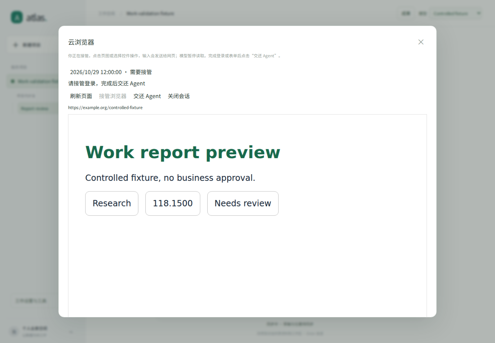
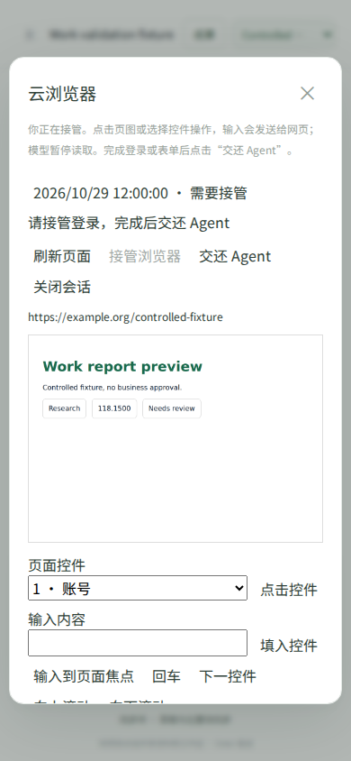
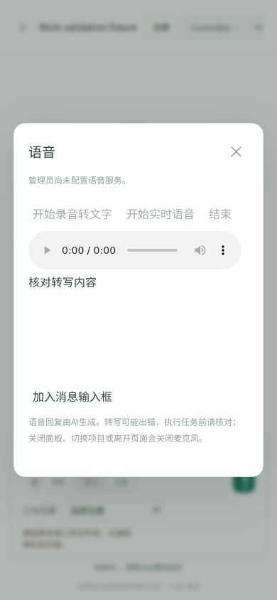

# 浏览器与媒体能力验证 · 2026-10-29

本轮加入独立 Chromium 服务、按账号与项目分配的容器绑定、应用内登录接管、图片生成与编辑、朗读、录音转写、WebRTC 语音和服务端挂断。部署与使用见 [BROWSER-AND-MEDIA.md](BROWSER-AND-MEDIA.md)。这些实现不等于已经完成 ChatGPT 全部能力或生产验收。

## 已完成的检查

| 检查 | 结果与覆盖范围 |
| --- | --- |
| 定稿代码相关 Python 回归 | **206 通过**；26 个新增用例，包含真实文件摘要、图片完整解码、付费请求不重放、引用、接管、权限、上传上限、媒体目的地、语音截止时间与挂断重试 |
| 前端 DOM 测试 | **22 个脚本通过**；真实应用模块配受控接口，检查接管、敏感输入清空、切换项目后麦克风释放、迟到权限与转写丢弃、不会自动发送工作 |
| 真实浏览器服务 | **通过**；真实 Chromium 153.0.8010.0 和本地 HTTP 网站。实际登录 POST 一次，重复动作不重放；Cookie 在会话内保留、会话间隔离；不同工作空间被拒绝；真实 PNG 截图；关闭后不可继续读取 |
| 真实桌面 / 手机前端 | **通过**；实际 Chromium 加载生产静态文件、受控 API 和实际 PNG，检查接管面板、交还后输入禁用、语音未配置状态、页图和无横向溢出 |
| 安装包 | wheel 构建通过；**158 个源码文件**与实际 wheel 逐字节比较一致，包含浏览器 helper、媒体模块、前端与现有 runner |
| 部署配置与静态检查 | Compose 结构、强制 runsc、内部网络、代理不开放端口、无主机挂载、Python / JavaScript 语法、文档链接和 Git 差异检查通过；未运行 Docker |

Python 相关回归命令：

```bash
python -m pytest tests/test_interactive_work.py tests/test_web_research.py tests/test_work_runtime.py \
  tests/test_workspace_artifacts.py tests/test_bounded_planning_context.py tests/test_agent_harness.py \
  tests/test_agent_workspace.py tests/test_context_working_set.py tests/test_owner_stop_async_jobs.py \
  tests/test_workflow_continuation_reuse.py -q
```

真实浏览器、前端与 wheel 的运行结果及源码摘要保存在 [机器可读记录](verification/interactive-work-20261029.json)。浏览器服务验证使用明确的本地测试模式，生产应用会拒绝这种模式；它证明浏览器操作协议，不能证明生产 gVisor 隔离。前端截图使用受控页面，不能当作已登录外部业务网站的证据。

## 全量回归记录

开发期间的完整运行记录为 **2154 通过、9 失败、34 跳过**（681.39 秒）。本次全量运行期间仍在追加工作空间绑定和媒体目的地限制，因此不能把它当作定稿代码的全量通过证明。

其中 7 项与上一轮独立确认的基线失败名称完全一致：跨进程协作、两项财务历史公式 / 精度、治理引用、隔离模板缺失、原生启动就绪超时、OCR wheel 清单。详情见 [上一轮验证](VALIDATION-GENERAL-WORK.md)，本轮未修改这些既有问题。

另外两项为本轮开发过程问题：新增逐字文件测试的指令缺少现有分类器识别的“文件”一词，已修正测试文案；构建指纹测试在旧进程缓存指纹后读到了开发期间变动的新源码。代码定稿后的 **206 项相关回归包含这两项，均通过**，并单独复测两项通过。最终没有重新执行整套全量测试，也没有宣称全量全绿。

## 界面截图

以下是实际 Chromium 截图，网页内容与 API 为测试资料。手机面板可向下滚动；控件输入、键盘焦点输入、页图点击和滚动均由用户在接管模式操作。







## 尚未执行的验收

本环境没有实际 Docker / gVisor 服务、外部站点登录账号或媒体模型凭据。因此未验证生产网络隔离、外部登录与验证码适配、真实图片服务生成或编辑、语音识别与合成质量、实际 WebRTC 音频与供应商挂断。语音 DOM 测试的麦克风是明确模拟接口；它验证生命周期，不验证声音。

当前浏览器自动操作范围是阅读、普通链接导航、滚动与截图；表单与登录由用户接管。网页上传下载、通用自动表单代理、多标签工作和桌面应用控制仍未内置。上线后须使用同一输入与交付标准进行实际任务验收，不能用单元测试数量推算与 ChatGPT 的能力对等程度。
